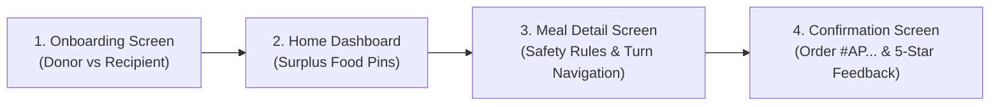

# 🍲 Akshaya Patram (Zero Food Waste Platform)

A full-stack mobile application that prevents urban food waste by connecting local food surplus with community recipients, NGOs, and shelters in real-time.

---

## 🚀 Quick Start (Running Backend & Frontend)

### 1. Start the Full-Stack Server
In your terminal, run:
```bash
npm start
```

The Express server will start at:
- **Web App (Frontend)**: [http://localhost:5000](http://localhost:5000)
- **API Health Check**: [http://localhost:5000/api/health](http://localhost:5000/api/health)
- **Surplus Meals API**: [http://localhost:5000/api/meals](http://localhost:5000/api/meals)

---

### 2. Start the Native React Native / Expo Mobile App
In another terminal tab, run:
```bash
npm run mobile
```
or:
```bash
cd mobile
npx expo start
```
- **On Physical Android/iOS Device**: Install **Expo Go** from Google Play Store or Apple App Store and scan the QR code shown in your terminal!
- **On Android Emulator**: Press `a` in the terminal to launch directly on your connected Android emulator.
- **On Web**: Press `w` in the terminal to launch in browser.

> You can also double-click [index.html](file:///c:/Users/ADITHYA/Desktop/akshaya/index.html) to open the frontend directly in any browser — it will automatically detect and connect to `http://localhost:5000/api`!

---

## 📱 Mobile Architecture & Screen Flows



1. **Onboarding Screen**:
   - Role selection: **I'm a DONOR (Donate Food)** with saffron-orange gradient card (`#F6964E` → `#EE6726`).
   - Role selection: **I'm a RECIPIENT (Request Food)** with deep ocean teal card (`#29838E` → `#1C5F67`).
   - Quick authentication with phone OTP and profile setup.

2. **Home Dashboard (Recipient View)**:
   - Interactive vector map of Bengaluru (HSR Layout, Koramangala, Indiranagar, Bellandur).
   - Real-time surplus food pins (`8 Meals`, `12 Meals`, `5 Meals`) with pulsing indicator.
   - Search location filter with live auto-complete.
   - **MAP VIEW** / **LIST VIEW** toggle switch.
   - GPS recenter button and floating **Nearby** radius button.
   - Bottom navigation tabs: *Home*, *My Requests*, *Notifications*, *Profile*.

3. **Food Detail Screen**:
   - Verified donor card for **Aisha Khan** with `4.7 ★` rating.
   - High-definition meal photo tagged with *FSSAI Certified Fresh*.
   - Portion specifications: `8 Meals - Vegetable Rice & Lentils (6kg)`.
   - Dietary badges: `Veg`, `Nut-Free`, `Low Spice`.
   - Live pickup countdown window (`2:00 PM - 5:00 PM Today`).
   - **Safety Guidelines Modal** with FSSAI 4-hour rule.
   - **Get Directions**: Launches in-app turn-by-turn GPS navigation mode with animated route and ETA!
   - **Accept Pickup**: Claims surplus meal, decrements inventory, and saves order in backend database.

4. **Confirmation & Feedback Screen**:
   - Animated green checkmark with headline *"Pickup Confirmed!"*.
   - Generated order receipt with unique token (e.g., `#AP987654`).
   - Notice confirming inventory deduction.
   - Interactive 5-star rating system with dynamic sentiment readout.
   - Quick feedback tags (*+ Fresh & Warm*, *+ Clean Packaging*, *+ Courteous Donor*).
   - Feedback notes textarea and **Submit & Finish** CTA that updates donor trust metrics.

---

## 🛠️ REST API Endpoints

| Method | Endpoint | Description |
| :--- | :--- | :--- |
| `GET` | `/api/health` | Service health status |
| `GET` | `/api/meals` | List all available surplus meals (supports `?q=`, `?dietary=`, `?status=`) |
| `GET` | `/api/meals/:id` | Fetch single meal listing |
| `POST` | `/api/meals` | Post new surplus food donation (Donor Flow) |
| `POST` | `/api/orders` | Accept pickup & lock inventory (Recipient Flow) |
| `GET` | `/api/orders` | List user orders for *My Requests* |
| `POST` | `/api/orders/:id/review` | Submit star rating and feedback review |
| `GET` | `/api/notifications` | Fetch unread surplus alerts |
| `GET` | `/api/user/profile` | Fetch user profile and impact metrics |
| `POST` | `/api/reset` | Reset database to default seed state |

---

## 📂 Project Directory Structure

```text
akshaya/
├── assets/                  # Original design photos and icons
├── data/
│   └── database.json        # Persistent JSON database (meals, orders, users, reviews)
├── index.html               # High-fidelity reactive mobile application frontend
├── server.js                # Express REST API backend server
├── package.json             # NPM dependencies (express, cors)
└── README.md                # Project documentation & execution guide
```

